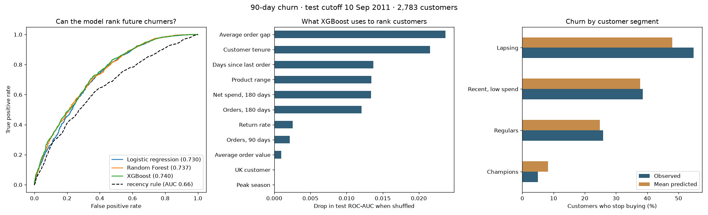

# Customer churn and RFM segmentation

Which customers are likely to stop ordering, and who should a retention team contact first?

Using two years of transactions from a UK online wholesaler, XGBoost reaches **0.740 ROC-AUC** on a later-quarter test, compared with **0.656** for a recency rule. Among the highest-risk 20% of customers, **64.7%** subsequently stop buying for 90 days.

This is a public-data rebuild of the churn and segmentation work I did as a Data Analyst at Think and Wash. Employer data is not included. The results below come from the public dataset, not the employment results on my resume.



The [analysis notebook](notebooks/eda.ipynb) includes executed outputs. The [test results](results/test_results.csv), [segment profiles](results/segments.csv) and [ranked customer list](results/scores.csv) are available without running the code.

## Data and cleaning

[UCI Online Retail II](https://archive.ics.uci.edu/dataset/502/online+retail+ii), December 2009 to December 2011: about 1.07 million invoice lines. The dataset is distributed under [CC BY 4.0](https://creativecommons.org/licenses/by/4.0/); source transactions are downloaded separately.

Dataset credit: Chen, D. (2012). *Online Retail II*. UCI Machine Learning Repository. [doi:10.24432/C5CG6D](https://doi.org/10.24432/C5CG6D). The cleaning steps below and customer-level outputs are transformations of that source.

The cleaning decisions matter to the call list:

- Remove exact duplicates, including the overlap between the two workbook sheets.
- Drop rows without a customer ID. Guest purchases cannot be linked over time.
- Exclude postage, fees, adjustments and test items.
- Keep returns and subtract them from spend. One customer placed and cancelled a £168,000 order on the same day; gross spend would give that customer an inflated priority.

## Evaluation

An active customer has bought in the **180 days before a cutoff**. Features describe that history; the label is whether they make **no purchase in the following 90 days**. Returns alone do not count as a purchase. The [snapshot test](test_churn.py) checks date boundaries and verifies that future transactions cannot change past features.

The final test cutoff is **10 September 2011**, with 2,783 customers and a 38.2% churn rate. Training uses five earlier snapshots, 90 days apart, totalling 14,869 customer-snapshots. Their label windows finish by the test cutoff. Customers can appear in both periods, as they would when rescoring an existing customer base.

Logistic regression, Random Forest and XGBoost use the same 11 features. Training cross-validation uses five folds grouped by customer, so one customer's snapshots stay in one fold. Model selection uses ROC-AUC; the classification threshold maximizes F1 on out-of-fold training predictions. Both choices are fixed before evaluating the test quarter. These grouped folds mix training periods; the later-quarter holdout is the temporal check.

Churn is 38–39% in the September–December windows, against 50–65% in other quarters. Training includes the previous year's comparable period and a calendar-based `peak_season` feature. With only two years of history, this is limited evidence of how seasonality will generalize.

| Model | ROC-AUC | F1 | Precision | Recall | Accuracy | Precision in top 20% |
|---|---:|---:|---:|---:|---:|---:|
| Always predict churn | 0.500 | 0.553 | 0.382 | 1.000 | 0.382 | 0.371 |
| No order in 90 days | 0.656 | 0.488 | 0.539 | 0.445 | 0.642 | 0.586 |
| Logistic regression | 0.730 | 0.623 | 0.530 | 0.757 | 0.650 | 0.601 |
| Random Forest | 0.737 | 0.619 | 0.537 | 0.732 | 0.656 | 0.644 |
| **XGBoost, selected by training CV** | **0.740** | **0.605** | **0.564** | **0.652** | **0.674** | **0.647** |

The constant baseline predicts the training majority class, which is churn. It has no useful ranking; its top-20% precision depends on tie order. Always predicting that customers stay would reach 61.8% accuracy in the test quarter. Accuracy alone is therefore a poor reason to choose a model.

The three fitted models are close. XGBoost was selected before the test, but Random Forest has a slightly higher test F1. Logistic regression is a reasonable option when simpler explanations matter more than the small AUC difference.

## What the retention team could use

The recency rule misses **590 of the 1,064 churners** because they had ordered within the last 90 days. The selected model catches 307 of those recent buyers. Order rhythm and tenure are its strongest ranking signals by permutation importance.

RFM segmentation uses log-scaled recency, order count and net spend. Four clusters give usable groups; silhouette is highest at two clusters, but among three to eight clusters, four scores best. The segment fit is descriptive, using test-period features without churn labels.

| Segment | Customers | Median recency | Share of net spend | Observed churn | Possible action |
|---|---:|---:|---:|---:|---|
| Champions | 301 | 8 days | 52.6% | 5.0% | Account support and loyalty benefits |
| Regulars | 887 | 44 days | 31.5% | 25.9% | Prioritize valuable customers flagged at risk |
| Recent, low spend | 337 | 7 days | 5.7% | 38.6% | Test a second-order offer |
| Lapsing | 1,258 | 103 days | 10.2% | 54.8% | Lower-cost win-back campaign |

[score.py](score.py) loads the saved model and scores **3,471 customers** as of the day after the dataset ends. It sorts by churn probability multiplied by historical six-month net spend. **This is a prioritization heuristic, not a forecast of revenue lost or evidence that a call prevents churn.** Filter `at_risk == 1` for the suggested call list. This file is a historical example, not a live customer feed.

## Run locally

Tested with Python 3.12. From the repository root:

```bash
python3 -m venv .venv
source .venv/bin/activate
python -m pip install -r requirements.txt
python test_churn.py
mkdir -p data
```

Download `online_retail_II.xlsx` from the UCI page into `data/`, then run:

```bash
python train.py
python score.py
```

Training creates `models/churn.joblib`, evaluation CSVs and the chart in `results/`. The first run also caches the Excel data as CSV. Raw data, the virtual environment and trained model are ignored by Git. To explore the notebook, install Jupyter separately in the same environment, then run all cells after training.

## Limits

One later quarter is not enough to establish performance across seasons. A useful next check is repeated temporal holdouts, followed by calibration checks before using probabilities for decisions. The model predicts inactivity, not whether an intervention will work; that needs a controlled retention experiment. The public dataset also differs from a laundry business in purchase frequency and customer behavior.
